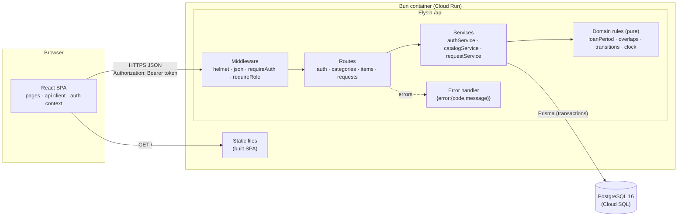
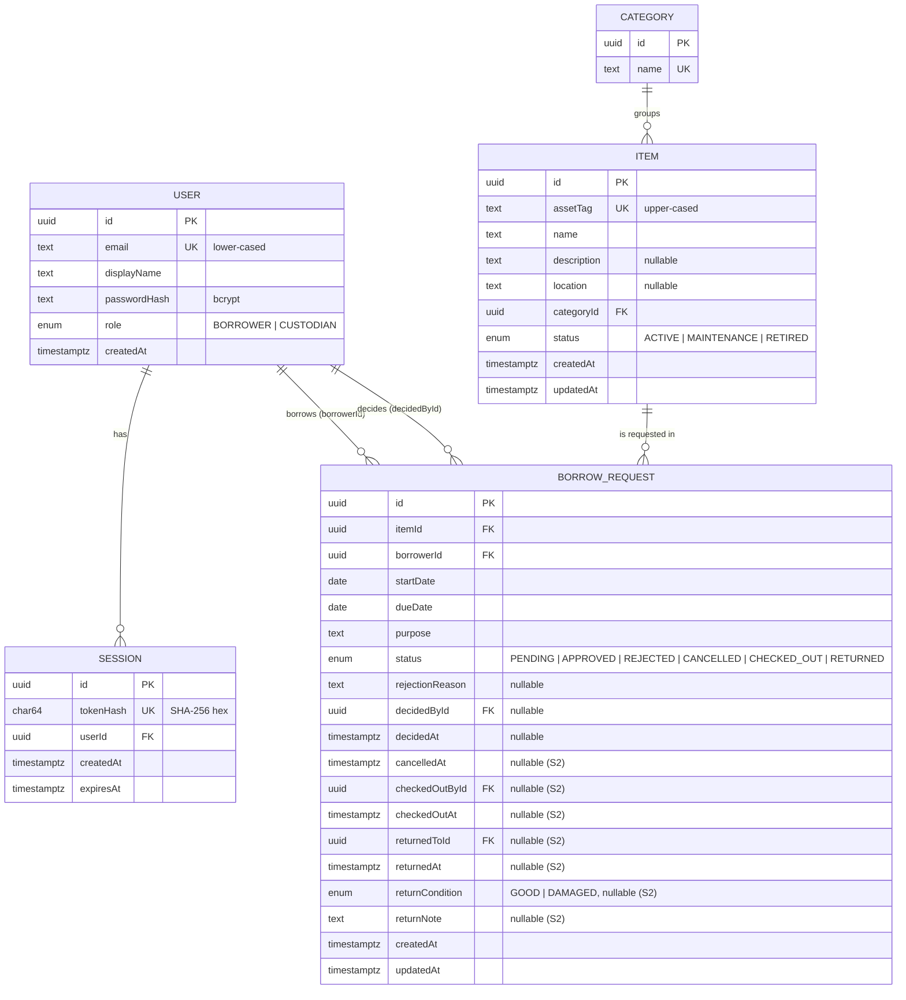
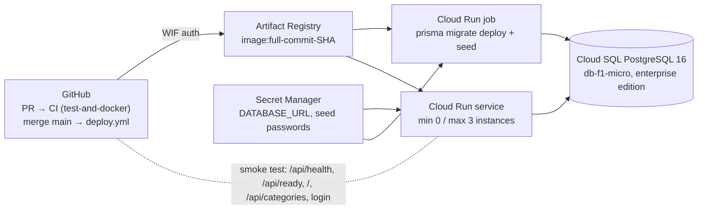

# Part C — System-Level Software Design Specification (SDS)

**Document version:** 0.2.1 (draft, 2026-11-12): entry point is `index.ts`; S2 columns are added in Sprint 2 (SR-01)
Requirement IDs refer to [srs.md](srs.md). Feature IDs refer to [features.md](features.md).

---

## C1. Architecture and stack

### C1.1 Stack

| Layer | Technology | Responsibility |
|---|---|---|
| UI | React 19 + Vite + React Router, TypeScript | Screens, navigation, form validation for fast feedback, display of API errors. Holds the session token in `sessionStorage`. **Enforces no rules authoritatively.** |
| API / application | Bun + Elysia, TypeScript, Zod for input validation. Types are shared with the client through Eden (`treaty<App>`) | Authentication, role and ownership authorization, input validation, **all business rules** (BR-01–14), transactions. |
| Data access | Prisma ORM + Prisma Migrate | Typed queries, migrations, seed. Raw SQL only for row locks (`SELECT … FOR UPDATE`). |
| Database | PostgreSQL 16 | Durable storage of users, sessions, categories, items, requests. Uniqueness, foreign keys and check constraints act as a last line of defence. |
| Tests | Vitest (unit + API), Supertest, React Testing Library, Playwright (E2E) | See [Sprint 1 STS](sprints/sprint-1/sts.md). |

In production, **one container** runs Elysia on Bun. It serves the built React app as static files and the API
under `/api` on the same origin, so no CORS is needed in production. In development, Vite (`:5173`) proxies
`/api` to Elysia (`:3000`). This matches the Lab 5 starter `Dockerfile`.

### C1.2 Component diagram



### C1.3 Where rules are enforced

| Concern | Enforced in | Notes |
|---|---|---|
| Input shape, required fields, lengths, date format | Route layer (Zod schemas) | → 400 `VALIDATION_ERROR` with `details[]` per field. |
| Authentication | `requireAuth` middleware | Resolves the Bearer token to a session and user, or returns 401. Sets `req.user`. |
| Role restrictions (BR-13) | `requireRole('CUSTODIAN' \| 'BORROWER')` middleware per route | → 403 `FORBIDDEN`. |
| Ownership (BR-14) | Service queries are scoped by `borrowerId = req.user.id` for Borrowers | Not found in scope → 404. |
| Business rules BR-01–BR-12 | **Services**, using pure functions in `domain/` | Pure functions are unit-tested. Services run checks and writes in one transaction. |
| Concurrency (NFR-05) | Service transaction: `SELECT … FROM "Item" WHERE id = $1 FOR UPDATE`, then overlap check, then conditional update | Serialises create/approve for the same item. |
| Last-line integrity | Database | Unique email, unique asset tag, FK constraints, `CHECK (due_date >= start_date)`. |
| UI checks | React forms | Same rules duplicated only for faster feedback. The server response is authoritative and is displayed as-is. |

### C1.4 Backend module layout (planned)

```
server/
  src/
    app.ts              # builds Elysia app (no listen) and exports `type App` for Eden
    index.ts            # listen(PORT); entry point of the kit Dockerfile (`bun src/index.ts`)
    config.ts           # reads + validates env (Zod); fails fast on missing values
    clock.ts            # today() in APP_TIMEZONE; injectable for tests
    middleware/         # requireAuth, requireRole, errorHandler, notFound
    domain/             # loanPeriod.ts, overlap.ts, transitions.ts (pure, no I/O)
    services/           # authService, catalogService, requestService
    routes/             # auth, health, categories, items, requests
    errors.ts           # AppError(code, status, message, details?)
  prisma/
    schema.prisma
    migrations/
    seed.ts
  test/
    unit/  api/  helpers/ (db reset, login helper, fixtures)
client/
  src/
    api/ (fetch wrapper adds Bearer, maps errors) · auth/ (AuthContext, RequireRole)
    pages/ · components/ · test/
e2e/   # Playwright specs
```

---

## C2. Data design

### C2.1 Entity–relationship diagram



### C2.2 Constraints and ownership

| Entity | Constraint | Purpose |
|---|---|---|
| User | `email` unique, stored lower-cased | Login lookup; no duplicate accounts. |
| Session | `tokenHash` unique; `onDelete: Cascade` from User | Lookup by hash; plaintext token never stored (NFR-04). |
| Category | `name` unique | Clean filter list. |
| Item | `assetTag` unique, stored upper-cased (BR-12 enforced in S2 service + DB) | Physical identity of a unit. |
| Item | `categoryId` FK `onDelete: Restrict` | A category with items cannot be deleted. |
| BorrowRequest | `CHECK (due_date >= start_date)` | Defence in depth for BR-01. |
| BorrowRequest | `itemId`, `borrowerId` FK `onDelete: Restrict` | Loan history is never orphaned. |
| BorrowRequest | Index `(itemId, status)`, index `(borrowerId, status)`, index `(status, createdAt)` | Overlap check, active-limit count, custodian queue. |

**Ownership links:** a `BorrowRequest` is owned by `borrowerId`. A Borrower's queries are always filtered by
it. `decidedById`, `checkedOutById` and `returnedToId` record which Custodian performed each step. Together
with the timestamps, they give a basic audit trail without a separate event table.

**Request lifecycle (BR-06):**

```mermaid
stateDiagram-v2
  [*] --> PENDING : Borrower submits (F-03)
  PENDING --> APPROVED : Custodian approves (F-05)
  PENDING --> REJECTED : Custodian rejects + reason (F-05)
  PENDING --> CANCELLED : Borrower cancels (F-06)
  APPROVED --> CANCELLED : Borrower cancels (F-06)
  APPROVED --> CHECKED_OUT : Custodian hands over (F-07)
  CHECKED_OUT --> RETURNED : Custodian receives (F-07)
  REJECTED --> [*]
  CANCELLED --> [*]
  RETURNED --> [*]
  note right of CHECKED_OUT : "Overdue" is derived:\ntoday > dueDate (F-08)
```

### C2.3 Database setup and migrations

- The schema lives in `server/prisma/schema.prisma`. Every change is a Prisma migration committed under
  `server/prisma/migrations/`. Migrations are **additive** (new columns are nullable or have defaults) so that
  a release can migrate before traffic moves (Lab 5 recommendation). The `CHECK` constraint is added by
  editing the generated migration SQL. The Sprint 1 `init` migration omits the columns marked `(S2)` in the
  ER diagram; Sprint 2 adds them in an additive migration.
- Local setup: `docker compose up -d db`, then `bunx prisma migrate dev` (development) or
  `bunx prisma migrate deploy` (CI, Docker, Cloud Run job).
- Tests use a separate database (`DATABASE_URL` pointing to `…/inventory_test`). It is migrated once per test
  run, and tables are truncated between API test files.

### C2.4 Seed data

`bun run prisma:seed` is **idempotent**: it upserts by email, category name and asset tag, so running it
again changes nothing. The demo booking is created only when `CPE-0201` has no `APPROVED` or `CHECKED_OUT`
request yet. A rerun (for example the migration job on every deploy) leaves an existing booking and its dates
unchanged.

| Data | Content |
|---|---|
| Categories | Microcontrollers, Single-board computers, Measurement instruments, Audio-visual |
| Items (12) | e.g. `CPE-0001` Arduino Uno R3, `CPE-0002` Arduino Uno R3, `CPE-0101` Raspberry Pi 5 kit, `CPE-0201` Rigol DS1054Z oscilloscope, `CPE-0202` Fluke 117 multimeter, `CPE-0301` Epson portable projector … including **one `MAINTENANCE`** and **one `RETIRED`** item to demonstrate BR-02 |
| Users | `custodian@example.test` (CUSTODIAN), `borrower1@example.test` and `borrower2@example.test` (BORROWER). Two borrowers are needed to demonstrate ownership (BR-14). |
| Requests (demo only) | One `APPROVED` request on `CPE-0201` from **today + 7 to today + 9** (dates computed when the seed runs, in `APP_TIMEZONE`), to demonstrate the overlap rejection (BR-03). Only created when `SEED_DEMO_REQUESTS=true`. CI and the E2E run set it to `false`, so tests never collide with it. |

Passwords come from the variables the kit's `docker-compose.yml` and `deploy/deploy.sh` already provide:
`ADMIN_PASSWORD` for the Custodian and `DEMO_USER_PASSWORD` for both Borrowers. As in the kit, the demo
users (the two Borrowers) are only created when `SEED_DEMO_DATA=true` (`deploy.sh --demo`; compose defaults to
`true`). The seed **fails** if `ADMIN_PASSWORD` is missing, or if `SEED_DEMO_DATA=true` and
`DEMO_USER_PASSWORD` is missing. They are never in Git, never printed, and in GCP they come from Secret Manager.

---

## C3. UI design

### C3.1 Screens and navigation

| Route | Screen | Who | Sprint |
|---|---|---|---|
| `/login` | Login form (email, password) | Anonymous | 1 |
| `/items` | Catalog: table/cards with category filter, status badge, "Available today" | Both | 1 |
| `/items/:id` | Item detail: description, location, committed periods. **Borrower:** "Request to borrow" form (start, due, purpose) | Both | 1 |
| `/my-requests` | Borrower's requests with status badges, rejection reason | Borrower | 1 |
| `/requests` | Custodian request list; default tab **Pending** (oldest first); Approve / Reject buttons; reject dialog with required reason | Custodian | 1 |
| `/requests/:id` | Request detail with lifecycle timestamps; Cancel / Checkout / Return actions | Both (scoped) | 2 |
| `/manage/items`, `/manage/items/new`, `/manage/items/:id` | Inventory management | Custodian | 2 |
| `/overdue` | Overdue loans | Custodian | 2 |
| `/dashboard` | Counts with links | Custodian | 3 |
| `/manage/categories`, `/reports` | Category management, CSV export | Custodian | 3 |

The **header** (all signed-in pages) shows the product name, role-appropriate navigation links, the user's
display name and role, and a **Log out** button. After login, Borrowers land on `/items` and Custodians on
`/requests`.

### C3.2 Shared UI behavior

| Situation | Behavior |
|---|---|
| Loading | Every data view shows a loading indicator (`role="status"`, text "Loading…"). Buttons that submit are disabled while their request is in flight, which prevents double submission. |
| Empty | Every list has an explicit empty message, e.g. "No items in this category" or "You have no requests yet". |
| Validation | Client-side checks mirror BR-01 and the required fields and are shown next to the field. Server `400` `details[]` are mapped onto the same fields. |
| Business-rule errors (409) | Shown in an alert above the form with the server `message`, e.g. "This item is already booked for part of that period." The form keeps the user's input. |
| 401 | For any call **except `POST /api/auth/login`**, the API client clears the stored token and redirects to `/login?expired=1`, which shows "Your session has ended. Please log in again." A 401 from the login call (`INVALID_CREDENTIALS`) stays on the form and shows the server message "Invalid email or password." (AC-09). |
| 403 | A "You are not allowed to do this" page or alert. Navigation to role-only routes is hidden, but the backend still enforces the rule. |
| 404 | A "Not found" page (also used for another borrower's request). |
| 5xx / network | A generic "Something went wrong. Please try again." with a Retry button. No technical details. |
| Status badges | `PENDING` grey, `APPROVED` blue, `CHECKED_OUT` purple, `RETURNED` green, `REJECTED` red, `CANCELLED` neutral. "Overdue" is an extra red label. Text is always shown, so colour alone carries no meaning. |
| Dates | Displayed as `10 Nov 2026`; entered with `<input type="date">`; sent as `YYYY-MM-DD`. |

---

## C4. API conventions

### C4.1 General rules

- Base path `/api`. JSON request and response bodies. Field names in `camelCase`. Dates as `YYYY-MM-DD`,
  timestamps as ISO-8601 UTC.
- Authentication: header `Authorization: Bearer <token>`.
- Actions that change state are named sub-resources using `POST`, e.g. `POST /api/requests/:id/approve`.
  This keeps each transition explicit and separately authorized.
- Unknown body fields are ignored. In particular, `borrowerId`, `status` and `decidedById` are **never**
  taken from the client.
- Successful creation → `201` with the created resource. Actions → `200` with the updated resource.
  Logout → `204`.

### C4.2 Error shape and codes

```json
{ "error": { "code": "PERIOD_UNAVAILABLE", "message": "This item is already booked for part of that period.", "details": [] } }
```

| HTTP | `code` | Meaning |
|---|---|---|
| 400 | `VALIDATION_ERROR` | Malformed input or a field rule (BR-01, BR-07, lengths). `details: [{ field, message }]`. |
| 401 | `UNAUTHENTICATED` | Missing, invalid, expired or logged-out token. |
| 401 | `INVALID_CREDENTIALS` | Login failed. The same message is used for an unknown email and a wrong password. |
| 403 | `FORBIDDEN` | Authenticated but the role is not allowed (BR-13). |
| 404 | `NOT_FOUND` | Resource missing or outside the caller's ownership scope (BR-14). |
| 409 | `ITEM_NOT_AVAILABLE` | BR-02 |
| 409 | `PERIOD_UNAVAILABLE` | BR-03 |
| 409 | `DUPLICATE_REQUEST` | BR-04 |
| 409 | `ACTIVE_LIMIT_REACHED` | BR-05 |
| 409 | `INVALID_TRANSITION` | BR-06 |
| 409 | `OVERDUE_BLOCK` | BR-08 (S2) |
| 429 | `TOO_MANY_ATTEMPTS` | NFR-14 (S2) |
| 500 | `INTERNAL_ERROR` | Unexpected error. Details are logged on the server only (NFR-06). |

### C4.3 Endpoint overview

Feature contracts define the exact request and response shapes. Sprint 1 endpoints are in
[sprints/sprint-1](sprints/sprint-1/README.md).

| Method & path | Purpose | Sprint |
|---|---|---|
| `GET /api/health` | `{ status: "ok", commit }` | 1 (commit: 2) |
| `GET /api/ready` | `{ db: "connected" }` after `SELECT 1` | 1 |
| `POST /api/auth/login` · `POST /api/auth/logout` · `GET /api/auth/me` | Session | 1 |
| `GET /api/categories` | Category list (public) | 1 |
| `GET /api/items` · `GET /api/items/:id` | Catalog | 1 |
| `POST /api/requests` · `GET /api/requests` · `GET /api/requests/:id` | Requests (role-scoped) | 1 |
| `POST /api/requests/:id/approve` · `POST /api/requests/:id/reject` | Review | 1 |
| `POST /api/requests/:id/cancel` · `/checkout` · `/return` · `GET /api/requests?overdue=true` | Lifecycle | 2 |
| `POST /api/items` · `PATCH /api/items/:id` · `POST /api/items/:id/status` | Inventory | 2 |
| `POST /api/categories` · `PATCH /api/categories/:id` | Categories | 3 |
| `GET /api/items?q=&freeFrom=&freeTo=` · `GET /api/items/:id/history` · `GET /api/dashboard` · `GET /api/reports/requests.csv` | Search, history, dashboard, report | 3 |

---

## C5. Roles, permissions and ownership

✅ = allowed · ❌ = 403 · "own" = only records where `borrowerId` = current user (others → 404).

| Operation | Anonymous | Borrower | Custodian |
|---|---|---|---|
| `GET /api/health`, `/api/ready`, `GET /api/categories` | ✅ | ✅ | ✅ |
| Log in | ✅ | ✅ | ✅ |
| Log out, current user | 401 | ✅ | ✅ |
| Browse catalog, item detail | 401 | ✅ (committed periods without borrower identity) | ✅ (with borrower name) |
| Create request | 401 | ✅ (owner = self) | ❌ |
| List / read requests | 401 | own | ✅ all |
| Approve / reject | 401 | ❌ | ✅ |
| Cancel (S2) | 401 | own | ❌ |
| Checkout / return (S2) | 401 | ❌ | ✅ |
| Overdue list (S2) | 401 | own (flag on own loans) | ✅ all |
| Manage items / categories (S2/S3) | 401 | ❌ | ✅ |
| Item history, dashboard, reports (S3) | 401 | ❌ | ✅ |

---

## C6. Authentication and session design

| Aspect | Design |
|---|---|
| Credentials | Email (case-insensitive) + password, checked against `User.passwordHash` with `bcrypt.compare`. When the email is unknown, the server still compares against a dummy hash so timing does not reveal which accounts exist. |
| Password hashing | bcrypt, cost `BCRYPT_COST` (12 in production, 4 in tests for speed). Hashing happens only in the seed (no self-registration). |
| Session creation | On successful login: `token = randomBytes(32).toString('base64url')`. Store `sha256(token)`, `userId` and `expiresAt = now + SESSION_TTL_HOURS` (default 8). Return `{ token, expiresAt, user }`. |
| Token transport | `Authorization: Bearer <token>`. The client keeps it in `sessionStorage` (DD-04). |
| Request authentication | `requireAuth` hashes the presented token, loads the session with its user, rejects a missing or expired session (and deletes an expired row), then sets `req.user = { id, email, displayName, role }`. |
| Current user | `GET /api/auth/me` returns `req.user`. Never returns `passwordHash` or session data. |
| Logout | `POST /api/auth/logout` deletes the session row for the presented token → 204. The client clears `sessionStorage` and goes to `/login`. Later use of the token → 401. |
| Hardening | `helmet` (CSP, no-sniff, frame-ancestors none), JSON body limit 100 kb, `trust proxy` on Cloud Run, login throttling in S2 with SR-02 (NFR-14), before the service is public. |

---

## C7. Configuration and delivery design

### C7.1 Environment variables

| Variable | Used by | Secret? | Source (local / GCP) | Purpose |
|---|---|---|---|---|
| `DATABASE_URL` | server, migrate job | **Yes** | `.env` / Secret Manager | PostgreSQL connection string |
| `PORT` | server | No | `.env` / Cloud Run (8080 injected) | HTTP port |
| `NODE_ENV` | server | No | `.env` / Dockerfile | `production` disables dev-only behavior |
| `APP_TIMEZONE` | server | No | default `Asia/Bangkok` | Defines "today" for BR-01, BR-09, overdue |
| `SESSION_TTL_HOURS` | server | No | default `8` | NFR-04 |
| `BCRYPT_COST` | server, seed | No | default `12` (tests: `4`) | NFR-03 |
| `ADMIN_PASSWORD` | seed | **Yes** | `.env` / Secret Manager | Custodian account password (kit name) |
| `DEMO_USER_PASSWORD` | seed | **Yes** | `.env` / Secret Manager | Borrower account passwords (kit name) |
| `SEED_DEMO_DATA` | seed | No | `.env` / `deploy.sh --demo` | Creates the Borrower demo users (kit name) |
| `SEED_DEMO_REQUESTS` | seed | No | `.env` (default `false`; `false` in CI and E2E) | Adds the demo booking on `CPE-0201` |
| `GIT_COMMIT_SHA` | server | No | Set at image build (`--build-arg`) | Reported by `/api/health` (NFR-10) |
| `CORS_ORIGIN` | server (dev only) | No | `.env` | Only when the client runs on a different origin |
| `VITE_API_URL` | client build | No | `client/.env` | API base URL; empty means same origin |

Rules: `.env` files are git-ignored. `.env.example` lists every variable with placeholders only. `config.ts`
validates the environment at startup and exits with a clear message naming the missing variable, never
printing its value. **No secret is ever placed in `VITE_*` variables**, because those are embedded in the
client bundle.

### C7.2 Planned GCP deployment (implemented in Lab 5 / Sprint 2)



- **Durable storage:** all state, including sessions, is in Cloud SQL. The container is stateless, so data
  survives restarts and redeploys (NFR-07).
- **Release identity:** the image is tagged with the full commit SHA and deployed by digest. `/api/health`
  returns the same SHA (NFR-10).
- **Cost control:** budget alert first, Cloud Run scales to zero, smallest Cloud SQL tier, storage
  auto-increase off, `deploy/teardown.sh` after the course.
- **Not required:** separate cloud staging environment, custom domain, load balancer (Lab 5 §4.2).
